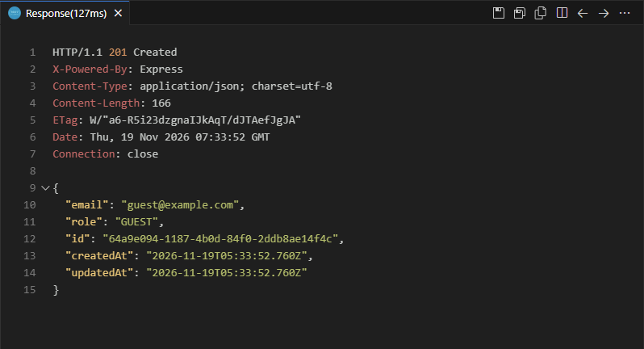
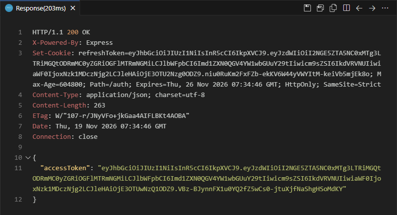
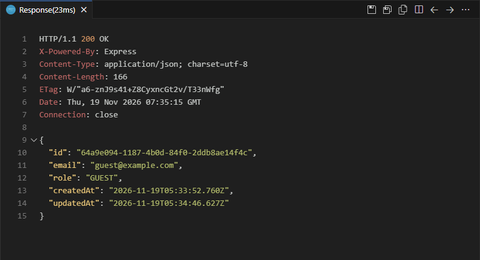
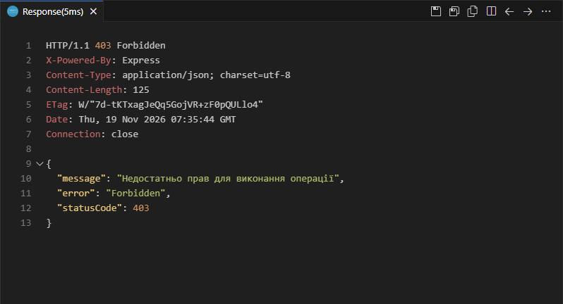
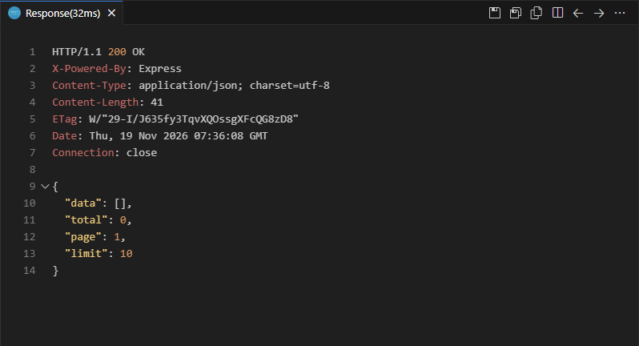
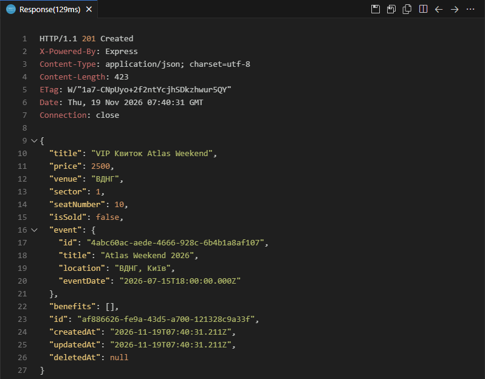
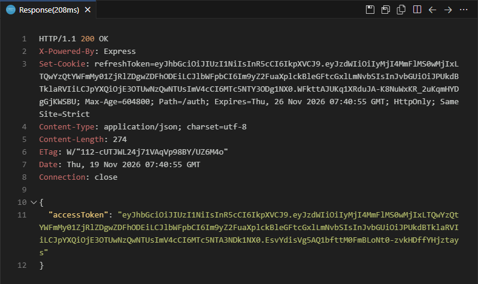
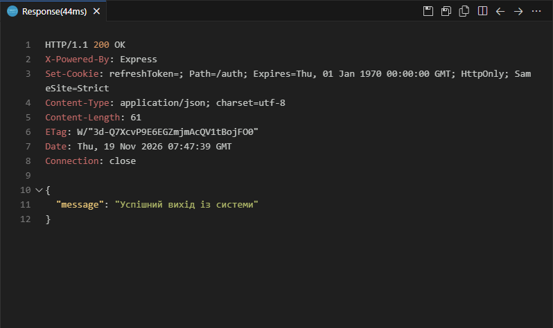
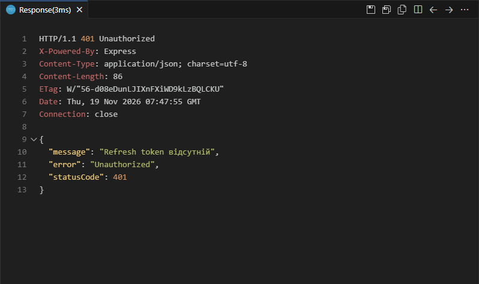

# Практична робота № 9

## Тема: Реалізація автентифікації та рольової авторизації

- **Студент:** Сочка Олександр
- **Варіант:** 8 (за журналом: 18)
- **Предметна область:** Квитки на події (`tickets`, `events`)
- **Ролі користувачів (`Role` enum):** `ADMIN`, `ORGANIZER`, `GUEST`
- **Публічні ресурси:** Перегляд афіші та подій (`GET /tickets`, `GET /tickets/:id`, `GET /tickets/events`, `GET /tickets/search`)
- **Привілейовані операції (RBAC):** Створення подій та типів квитків, редагування, видалення (`ORGANIZER`, `ADMIN`)

---

## 1. Мета роботи

1. Опанувати принципи побудови безпечної підсистеми автентифікації та авторизації у серверних застосунках NestJS.
2. Навчитися безпечно хешувати та верифікувати паролі користувачів за допомогою бібліотеки `bcrypt`.
3. Засвоїти роботу з протоколом JSON Web Token (JWT), налаштувати генерацію та підписування токенів за допомогою `@nestjs/jwt`.
4. Навчитися захищати маршрути контролерів за допомогою бібліотеки `@nestjs/passport` та стратегії `passport-jwt`.
5. Опанувати створення кастомних параметричних декораторів (`@CurrentUser()`) та маркерів метаданих (`@Public()`).
6. Спроєктувати та реалізувати систему рольового контролю доступу (RBAC) за допомогою перелічень (`enum`), рефлексії метаданих (`Reflector`) та авторизаційних гардів (`RolesGuard`).
7. Реалізувати безпечну ротацію сесій за схемою подвійних токенів (Access Token у відповіді + Refresh Token у захищеному заголовку `HttpOnly Cookie`) та анулювання сесії (`Logout`).

---

## 2. Архітектура та структура проєкту

Для реалізації завдань практичної роботи розроблено модульну структуру відповідно до варіанта №8:

- **`UsersModule` (`src/users`):**
  - `UserEntity` — сутність користувача (`id`, `email`, `passwordHash`, `role`, `hashedRefreshToken`, `createdAt`, `updatedAt`).
  - `Role` — перелічення ролей (`ADMIN`, `ORGANIZER`, `GUEST`).
  - `UsersService` — методи пошуку користувача за email/id, збереження нового користувача та оновлення хешу refresh токена.
- **`AuthModule` (`src/auth`):**
  - `RegisterDto` — валідація формату email та мінімальної довжини пароля (6 символів).
  - `LoginDto` — перевірка обов'язкових облікових даних.
  - `AuthService` — хешування паролів із сіллю (`saltRounds = 10`), верифікація паролів, випуск Access/Refresh токенів, ротація токенів, очищення сесії при виході.
  - `JwtStrategy` — розширення `PassportStrategy(Strategy)` для екстракції Bearer токена та валідації payload.
  - `JwtAuthGuard` — глобальний гард, що перевіряє JWT токени для всіх ендпоінтів, окрім відкритих.
  - `RolesGuard` — авторизаційний гард на базі `Reflector`, що зіставляє ролі користувача з метаданими обробника.
  - Декоратори: `@Public()`, `@CurrentUser()`, `@Roles()`.
  - `AuthController` — ендпоінти реєстрації, авторизації, профілю, оновлення токенів та виходу.
- **`TicketsModule` (`src/tickets`):**
  - Ресурс каталогу квитків та подій із попередньої роботи. Маршрути читання (`GET`) позначені декоратором `@Public()`, а маршрути мутації даних (`POST`, `PATCH`, `DELETE`) закриті декоратором `@Roles(Role.ORGANIZER, Role.ADMIN)`.

---

## 3. Інструкція із запуску

### Крок 1. Запуск бази даних PostgreSQL у Docker
```bash
docker compose up -d
```

### Крок 2. Встановлення залежностей
```bash
npm install
```

### Крок 3. Налаштування змінних оточення
Файл `.env` у корені проєкту:
```env
PORT=3000
DB_HOST=localhost
DB_PORT=5432
DB_USERNAME=nest_user
DB_PASSWORD=nest_password
DB_DATABASE=store_db

JWT_ACCESS_SECRET=super_secret_access_key_lab9
JWT_ACCESS_EXPIRES_IN=15m
JWT_REFRESH_SECRET=super_secret_refresh_key_lab9
JWT_REFRESH_EXPIRES_IN=7d
```

### Крок 4. Запуск сервера у режимі розробки
```bash
npm run start:dev
```

---

## 4. Результати тестування та демонстрація роботи

Тестування API проводилося за допомогою файлу `requests.http` у Visual Studio Code (розширення REST Client).

### 4.1. Реєстрація нового користувача (Рівень 1)
Реєстрація звичайного клієнта з роллю за замовчуванням `GUEST`. Пароль безпечно хешується `bcrypt` із коефіцієнтом соління 10.

  
*Скріншот 1: Успішна реєстрація покупця квитків (HTTP 201 Created, повернення даних без хешу пароля).*

---

### 4.2. Логін користувача та отримання Access Token і HttpOnly Cookie (Рівень 1, 3)
Під час аутентифікації перевіряється збіг пароля. У разі успіху повертається JSON із короткоживучим `accessToken`, а довгоживучий `refreshToken` встановлюється в заголовок `Set-Cookie` із прапорцями `HttpOnly` та `SameSite=Strict`.

  
*Скріншот 2: Успішний логін клієнта з отриманням Access Token та cookie refreshToken.*

---

### 4.3. Отримання профілю авторизованого користувача GET /auth/me (Рівень 1, 2)
Запит до захищеного маршруту з передачею заголовка `Authorization: Bearer <token>`. Декоратор `@CurrentUser()` вилучає дані поточного користувача.

  
*Скріншот 3: Ендпоінт /auth/me повертає профіль поточного користувача.*

---

### 4.4. Перевірка рольового контролю доступу: відхилення неавторизованої операції (Рівень 2)
Спроба користувача з роллю `GUEST` створити новий квиток (`POST /tickets`). `RolesGuard` перевіряє необхідні ролі (`ORGANIZER`, `ADMIN`) і повертає `403 Forbidden`.

  
*Скріншот 4: Відповідь 403 Forbidden при спробі створення квитка звичайним гостем.*

---

### 4.5. Публічний перегляд каталогу товарів / квитків (Рівень 2)
Запит на отримання списку квитків виконується без жодних токенів авторизації завдяки маркеру `@Public()`.

  
*Скріншот 5: Публічний доступ до каталогу квитків без заголовка Authorization.*

---

### 4.6. Логін організатора та успішне створення квитка (Рівень 2)
Користувач з роллю `ORGANIZER` успішно створює подію та квиток до неї відповідно до індивідуального варіанта.

  
*Скріншот 6: Успішне створення квитка привілейованим користувачем ORGANIZER (HTTP 201 Created).*

---

### 4.7. Оновлення сесії через POST /auth/refresh (Рівень 3)
Оновлення пари токенів за допомогою переданого браузером або REST Client `HttpOnly Cookie`. Здійснюється перевірка валідності токена, порівняння з хешем у базі даних, генерація нової пари та ротація хешу в БД.

  
*Скріншот 7: Ротація сесії через ендпоінт /auth/refresh із перевипуском токенів.*

---

### 4.8. Завершення сесії POST /auth/logout (Рівень 3)
Вихід із системи: поле `hashedRefreshToken` у базі даних занулюється, а cookie `refreshToken` видаляється у клієнта через `res.clearCookie()`.

  
*Скріншот 8: Успішний логаут та очищення сесії.*

---

### 4.9. Захист від повторного використання старого токена після логауту (Рівень 3)
Спроба повторного звернення до `/auth/refresh` після логауту призводить до помилки `401 Unauthorized`, оскільки хеш у базі відсутній або cookie очищено.

  
*Скріншот 9: Помилка 401 Unauthorized при спробі оновити сесію після завершення.*

---

## 5. Відповіді на контрольні питання

### 1. Чому паролі користувачів категорично заборонено зберігати у базі даних у відкритому вигляді або за допомогою простих алгоритмів хешування типу MD5 чи SHA-256?
Зберігання у відкритому вигляді призводить до повної компрометації облікових даних у разі витоку дампу БД. Алгоритми типу MD5 або SHA-256 є швидкими криптографічними хеш-функціями загального призначення: вони вразливі до атак перебором на GPU (мільярди хешів на секунду) та пошуку за райдужними таблицями (Rainbow Tables). Для паролів слід використовувати спеціалізовані повільні адаптивні алгоритми (наприклад, `bcrypt`, `argon2`), де складність обчислень регулюється параметром соління та ітерацій.

### 2. Що таке «сіль» (`salt`) у криптографічному хешуванні та від яких типів атак вона забезпечує захист?
«Сіль» — це випадковий набір бітів або символів, що генерується для кожного пароля індивідуально перед обчисленням хешу і зберігається разом із результатом. Вона унеможливлює використання попередньо обчислених словників (райдужних таблиць) і гарантує, що два користувачі з однаковими паролями матимуть абсолютно різні фінальні хеші.

### 3. З яких трьох базових складових складається JSON Web Token (JWT)? Яка інформація міститься у заголовку, корисному навантаженні та підписі?
JWT складається з трьох частин, розділених крапками (`Header.Payload.Signature`):
1. **Header (Заголовок):** тип токена (`typ: "JWT"`) та алгоритм хешування підпису (наприклад, `alg: "HS256"`).
2. **Payload (Корисне навантаження):** набір тверджень (`claims`) про користувача — ідентифікатор (`sub`), пошта, роль, термін придатності (`exp`), дата випуску (`iat`).
3. **Signature (Цифровий підпис):** результат хешування заголовка та пейлоаду з використанням секретного ключа сервера (`HMACSHA256(base64UrlEncode(header) + "." + base64UrlEncode(payload), secret)`). Забезпечує контроль цілісності даних.

### 4. У чому полягає відмінність між автентифікацією (`Authentication`) та авторизацією (`Authorization`)?
- **Автентифікація (Authentication):** процес перевірки справжності суб'єкта — встановлення відповідності, чи користувач є тим, за кого себе видає (введення логіна/пароля, перевірка токена).
- **Авторизація (Authorization):** процес перевірки прав доступу вже автентифікованого користувача до виконання конкретної операції або доступу до конкретного ресурсу (наприклад, чи має користувач з роллю `GUEST` право видаляти квиток).

### 5. Яку роль відіграє `PassportStrategy` у NestJS та в який момент життєвого циклу запиту викликається її метод `validate()`?
`PassportStrategy` інкапсулює логіку вилучення та верифікації облікових даних (у нашому випадку витягування Bearer JWT із заголовка `Authorization` та перевірки його цифрового підпису). Її метод `validate()` викликається автоматично після успішної криптографічної перевірки валідності токена та терміну його дії, безпосередньо перед передачею керування контролеру. Об'єкт, який повертає метод `validate()`, автоматично записується у `request.user`.

### 6. Чому зберігання токенів доступу у `localStorage` браузера є небезпечним та які переваги надає прапорець `HttpOnly` у заголовку `Set-Cookie`?
Дані в `localStorage` доступні будь-якому JavaScript-коду на сторінці. Якщо зловмисник знайде XSS-вразливість (Cross-Site Scripting) або вбудує шкідливу сторонню бібліотеку, він може безперешкодно прочитати токен і викрасти його.  
Прапорець `HttpOnly` забороняє будь-якому клієнтському JavaScript доступ до cookie (`document.cookie` повертає порожній рядок або не бачить цей токен). Cookie автоматично додається браузером до HTTP-запитів на відповідні шляхи, що захищає Refresh Token від XSS-крадіжки.

### 7. Як влаштований механізм рольового контролю доступу (RBAC) за допомогою декоратора `@SetMetadata()` та класу `Reflector`?
1. Декоратор `@Roles(...roles)` за допомогою вбудованої утиліти `SetMetadata('roles', roles)` додає масив дозволених ролей до метаданих конкретного методу-обробника або класу контролера.
2. Авторизаційний гард `RolesGuard` реалізує інтерфейс `CanActivate`.
3. У методі `canActivate(context)` гард використовує сервіс `Reflector.getAllAndOverride()` для зчитування списку дозволених ролей із метаданих поточного обробника.
4. Якщо ролі задані, гард порівнює їх із роллю автентифікованого користувача (`request.user.role`). Якщо збігу немає — викидається `ForbiddenException`.

### 8. У чому полягає призначення концепції подвійних токенів (Access Token + Refresh Token)? Чому час життя Access Token має бути коротким?
Концепція подвійних токенів поєднує безпеку та швидкодію:
- **Access Token** використовується для кожного звернення до API. Він валідується локально сервером без запиту до БД за допомогою секретного ключа. Якщо зловмисник його перехопить, він буде дійсним лише короткий проміжок часу (наприклад, 15 хвилин), що суттєво мінімізує збитки.
- **Refresh Token** використовується рідко і виключно для отримання нової пари токенів. Він має довгий час життя, зберігається у захищеній cookie та контролюється в БД сервера.

### 9. Як працює механізм ротації Refresh токенів та чому необхідно хешувати Refresh Token перед збереженням у базу даних?
- **Ротація токенів (Refresh Token Rotation):** при кожному виклику ендпоінта оновлення сесії старий Refresh Token визнається недійсним, а замість нього генерується і записується абсолютно нова пара (новий Access та новий Refresh Token). Якщо зловмисник спробує скористатися старим токеном або перехопить його, виникає колізія, і сесія негайно анулюється.
- **Хешування у базі:** так само як і паролі, відкриті refresh токени не можна тримати в БД. У разі витоку або несанкціонованого доступу до бази даних зловмисник міг би використати наявні відкриті refresh токени для генерації дійсних сесій. Збереження хешу (`bcrypt.hash`) захищає від цієї загрози.

---

## 6. Висновок

У ході виконання практичної роботи №9 було реалізовано комплексну підсистему аутентифікації та рольової авторизації для інтернет-каталогу квитків на події (Варіант №8):
1. Створено сутність `UserEntity` та налаштовано безпечне збереження паролів із використанням алгоритму `bcrypt` та солінням.
2. Впроваджено аутентифікацію на основі JSON Web Token (JWT) за допомогою бібліотек `@nestjs/jwt` та `@nestjs/passport`.
3. Створено кастомні декоратори `@CurrentUser()`, `@Public()`, `@Roles()` та реалізовано гард `RolesGuard` для гнучкого контролю доступу (RBAC). Мутуючі маршрути квитків надійно захищено для адміністративних ролей (`ORGANIZER`, `ADMIN`), тоді як читання залишено публічним.
4. Організовано повноцінну безпечну роботу із сесіями за схемою подвійних токенів: випуск `refreshToken` у захищених `HttpOnly Cookie`, безпечна ротація сесій на маршруті `/auth/refresh` та анулювання сесій через `/auth/logout`.
